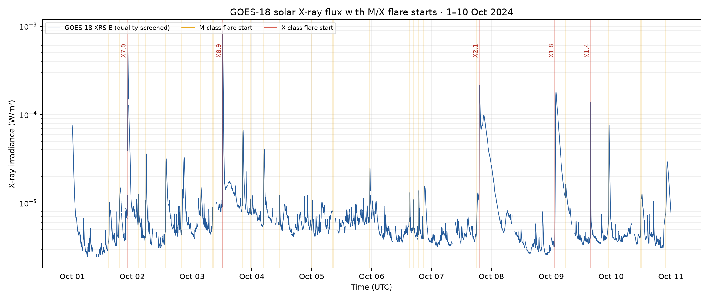
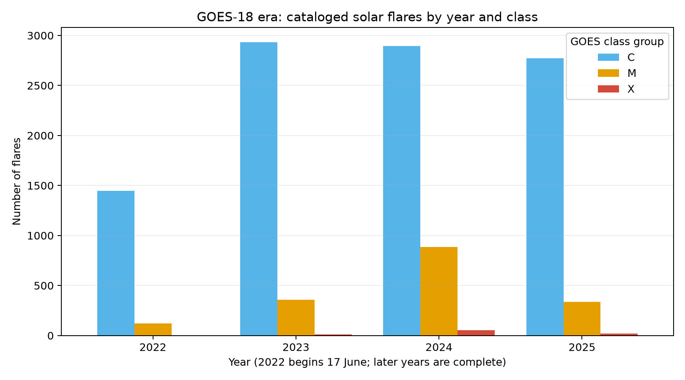
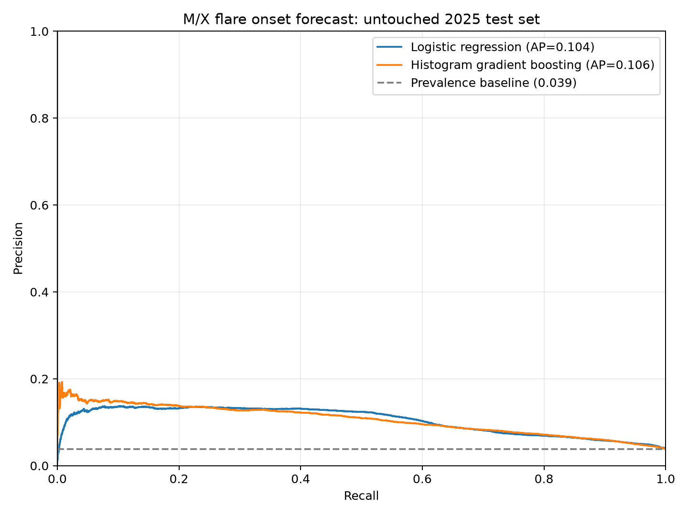
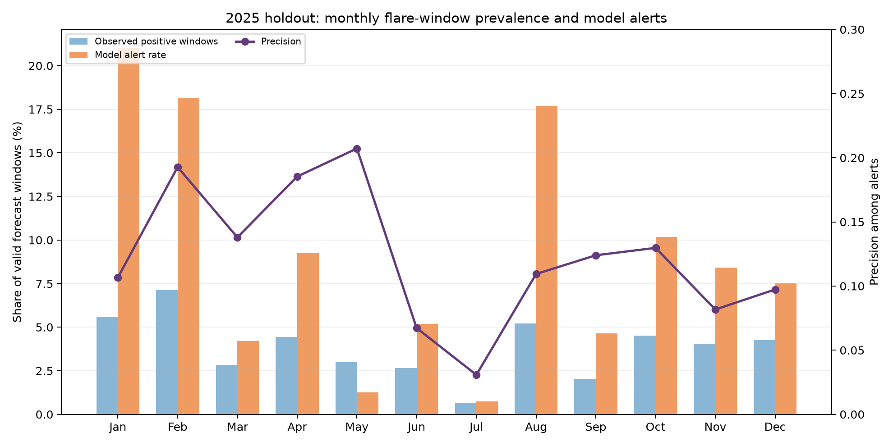

# Solar Flare Forecasting: visual project summary

## The question

Can recent GOES-18 soft X-ray measurements help estimate whether an M-class-or-stronger flare will begin within the next 60 minutes? This is a retrospective portfolio analysis, not an operational warning system.

## Dataset and scope

- Official NOAA science-quality GOES-18 XRS measurements at one-minute cadence, June 2022–December 2025.
- NOAA event catalog used to label flare start times and peak irradiance classes.
- 1,863,360 timestamps; 1,773,226 quality-screened XRS-B values; 350,060 five-minute modeling rows.
- Target: M/X flare start in `(t, t + 60 minutes]`; features use only information at or before `t`.

## 1. What a flare looks like in the measured signal

This active interval illustrates the scale and timing of real XRS-B measurements. Vertical lines mark cataloged M- and X-class flare starts; X-class events are labeled. It is an example interval, not the model test set.

## 2. How activity varied across the study years

2022 begins on 17 June because GOES-18 observations start then. Annual counts are descriptive and reflect changing solar activity; they are not directly comparable as rates without accounting for exposure and solar-cycle variation.

## 3. How the models performed on the untouched 2025 period

Average precision was 0.104 for logistic regression and 0.106 for histogram gradient boosting, versus a 0.039 prevalence baseline. The thresholds were chosen using 2024 validation data. On the overlapping five-minute windows, gradient boosting reached 0.30 recall and 0.13 precision at a 9.01% alert rate.

## 4. How alert rates changed by month in the holdout year

The threshold remains fixed across 2025. Month-to-month variation highlights why a single summary score is not enough for a rare-event forecasting problem.

## 5. What happens when alerts are grouped by flare event?

Window scores can make a run of adjacent alerts look like many independent successes. Grouping alerts into episodes gives a more conservative view: under the documented rule, histogram gradient boosting detected 16% of distinct 2025 M/X events, and 7% of alarm episodes were followed by an event within one hour. This exposes a substantial false-alert and missed-event problem. See the [event-level evaluation](first_model_evaluation.md#event-level-alarm-episodes) and its [CSV table](tables/event_level_test_2025.csv).

## Evaluation design and limitations

- Train: June 2022–2023; validation: 2024; final test: 2025.
- Year boundaries are kept outside the 60-minute target horizon.
- Features include recent log flux, short-term variability and trend, and the A/B channel hardness ratio.
- Samples overlap in time, so window-level recall is not the percentage of distinct flares successfully forecast.
- Event-level evaluation uses a specific 60-minute quiet-gap and forward-match rule; alternative alert policies, calibration, uncertainty, and simple flux-threshold comparisons remain to be studied.

## Detailed artifacts

- [Initial data audit](initial_data_audit.md)
- [First model evaluation](first_model_evaluation.md)
- [Annual event-count table](tables/flare_counts_by_year.csv)
- [Monthly 2025 test table](tables/monthly_test_metrics_2025.csv)
